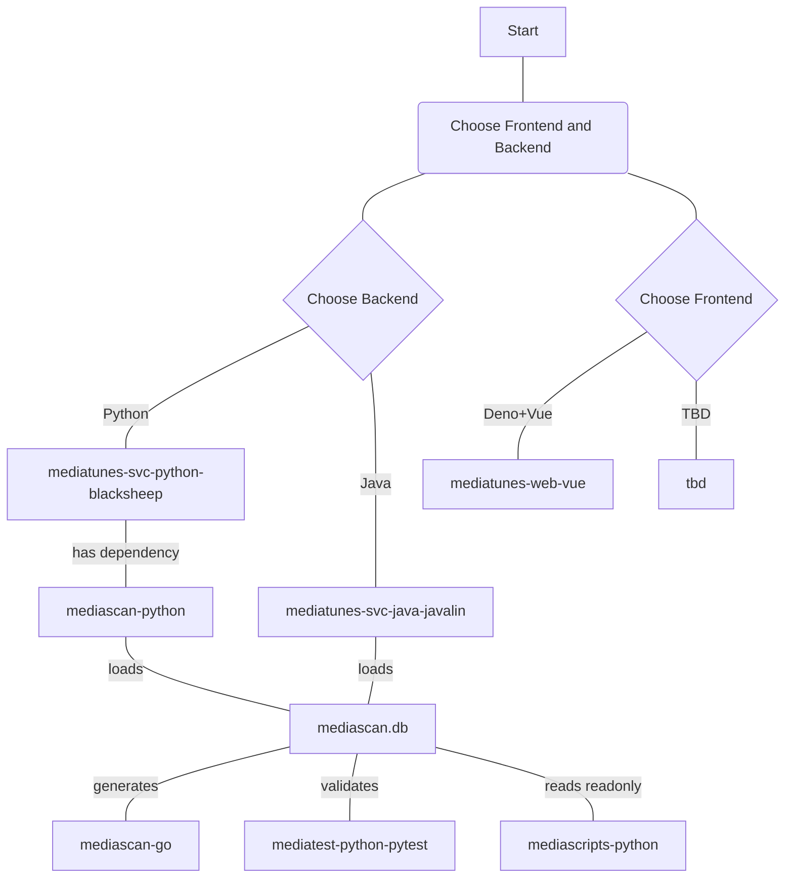

# moongas-mediascan-python

> 🚧 **Status: Work in Progress (WIP)**  
> This project is currently under active development. Features, APIs, and documentation are subject to change.

---

## Overview

**Python library for working with Moongas mediascan database files and metadata files.**

### A component of the `moongas` ecosystem of media library tools

- [moongas-collection-demo](https://github.com/moongas-org/moongas-collection-demo) [](https://github.com/moongas-org/moongas-collection-demo/actions/workflows/ci.yml) - Example Moongas media collection (metadata only)
- [moongas-mediatunes-web-vue](https://github.com/moongas-org/moongas-mediatunes-web-vue) [](https://github.com/moongas-org/moongas-mediatunes-web-vue/actions/workflows/ci.yml) - A Deno-tooled TypeScript/Vue SPA for Moongas hybrid media collections, pairing with the separate moongas-mediatunes-svc-python-blacksheep backend to seemlessly blend offline and streaming playback
- [moongas-mediatunes-svc-python-blacksheep](https://github.com/moongas-org/moongas-mediatunes-svc-python-blacksheep) [](https://github.com/moongas-org/moongas-mediatunes-svc-python-blacksheep/actions/workflows/ci.yml) - Python+BlackSheep implementation of API service for Moongas hybrid media collections—backend for Moongas mediatunes web application (moongas-mediatunes-web-vue)
- [moongas-mediatunes-svc-java-javalin](https://github.com/moongas-org/moongas-mediatunes-svc-java-javalin) [](https://github.com/moongas-org/moongas-mediatunes-svc-java-javalin/actions/workflows/ci.yml) - Java+Javalin implementation of API service for Moongas hybrid media collections—backend for Moongas mediatunes web application (moongas-mediatunes-web-vue)
- [moongas-mediascan-go](https://github.com/moongas-org/moongas-mediascan-go) [](https://github.com/moongas-org/moongas-mediascan-go/actions/workflows/ci.yml) - Golang module to scan media collections and Moongas Yaml metatadata, outputs Moongas database
- [moongas-mediascan-python](https://github.com/moongas-org/moongas-mediascan-python) [](https://github.com/moongas-org/moongas-mediascan-python/actions/workflows/ci.yml) - Python library with data classes for loading Moongas mediascan databases and Yaml metadata files
- [moongas-mediascripts-python](https://github.com/moongas-org/moongas-mediascripts-python) [](https://github.com/moongas-org/moongas-mediascripts-python/actions/workflows/ci.yml) - Python scripts for working with Moongas media collections.
- [moongas-mediatest-python-pytest](https://github.com/moongas-org/moongas-mediatest-python-pytest) [](https://github.com/moongas-org/moongas-mediatest-python-pytest/actions/workflows/ci.yml) - Python tool for enforcing media collection rules (implemented with `pytest`)

## Live Demos
- [Live Demo](https://moongas.org/mediatunes)



# Quick Start

```bash
pip install "git+https://github.com/moongas-org/moongas-mediascan-python.git"
```

### (Developer) Clone GitHub repo and install (editable)

```bash
git clone git@github.com:moongas-org/moongas-mediascan-python.git
cd moongas-mediascan-python
python -m pip install -e ".[dev]"
```

### Optional dependency groups

- `[dev]` - development dependencies (includes `pytest` and `ruff`)

### Track streaming data

`StreamingService` in `mediascan.types.track.streaming.streaming_service` is a
string enum of streaming service names, for example `StreamingService.Spotify`
(`"spotify"`) and `StreamingService.AppleMusic` (`"apple-music"`).

In `TrackIdData`, `streaming_data` replaces
the old top-level `isrc` and service-specific fields such as `spotify_id`.
Move those identifiers into entries shaped like this:

```yaml
trackIdData:
  streamingData:
    - streamingService: spotify
      isrc: USSM10027739
      trackUrl: https://open.spotify.com/track/0ZYf6N5eBeXStMri0mf3DZ
      trackId: 0ZYf6N5eBeXStMri0mf3DZ
      apiData:
        tracks:
          items: []
mediaFileData:
  - fpcalcData:
      duration: 263.62
      fingerprint: example-fingerprint
    acoustidData:
      status: ok
      results: []
```

`TrackYamlFile.track_id_data` is a single optional `TrackIdData` object, serialized
as a `trackIdData` mapping rather than a list. Its `streamingData` field remains
a list so one track can have multiple streaming identifiers. Track files without
identifiers may omit `trackIdData`.
For Spotify entries, `apiData` retains the complete search response as a nested
mapping, including paging metadata and all returned tracks. The Spotify-specific
streaming model keeps this subtree unmodified, including fields unknown to the
current mediascan model.

`TrackYamlFile.media_file_data` is an optional list of `MediaFileData` entries.
`fpcalc_data` and `acoustid_data` belong to each media-file entry, not to
`TrackIdData`. All media-file fields are optional, so fingerprint-only entries
are supported without inventing file paths or tag values. Existing complete
media-file entries remain supported. Media-file entries also support fractional
`duration` values and RFC 3339 `modTime` timestamps. Unlike the Go model, this
package omits `albumPath` and `artistPath` from media-file metadata; database
columns and joins are unchanged.

`mediascan.types.track.streaming.streaming_data.StreamingData` accepts raw API
data for any service (including `None`). For typed Spotify search results, use
`StreamingSpotifyData` and `SpotifyAPIData` from
`mediascan.types.track.streaming.streaming_spotify_data`:

```python
from mediascan.types.track.streaming.streaming_spotify_data import (
    SpotifyAPIData,
    StreamingSpotifyData,
)

spotify = StreamingSpotifyData(
    streaming_service="spotify",
    track_url="https://open.spotify.com/track/0ZYf6N5eBeXStMri0mf3DZ",
    track_id="0ZYf6N5eBeXStMri0mf3DZ",
    isrc="USSM10027739",
    api_data=SpotifyAPIData.from_yaml(raw_spotify_response),
)
```

Here `raw_spotify_response` is the raw JSON or YAML response text. The Spotify
models cover pagination, tracks, albums, artists, artwork, external URLs, and
external IDs, preserving Spotify's snake_case API keys during serialization.
Loading a track file keeps `api_data` as raw data, matching Go's generic streaming
entries; loading `StreamingSpotifyData` directly produces typed nested objects.

### Track YAML validation

`validate_track_yaml_content` in
`mediascan.types.track.track_yaml_file_validator` returns the parsed mapping on
success and raises `ValueError` for invalid schema or field types. YAML syntax
errors propagate as `yaml.YAMLError`. It rejects duplicate and unsupported fields,
requires the six core metadata fields with non-empty strings and an integer year,
and validates streaming identifiers, fingerprints, and nested AcoustID results.
Optional media-file fields may be omitted or null, and fractional durations and
quoted or YAML-native modification timestamps are supported. Raw `apiData`
payloads remain unrestricted.

### Go schema alignment

The Python models mirror the current `moongas-mediascan-go` working-tree types:

- `Date` now lives in `mediascan.types.date.date`, shared by artist and album data.
- `Artist`, `Album`, and `Track` in their respective type packages wrap YAML
  metadata with a `path`. Artist and album paths refer to their directories;
  track paths refer to their YAML files.
- Fingerprint and AcoustID types now live under `mediascan.types.media_file`:
  `MediaFileFpCalcData`, `MediaFileAcoustIDData`, `MediaFileAcoustIDResult`,
  and `MediaFileAcoustIDRecording`. The old track-prefixed modules were removed.
- Artist metadata no longer includes `members`. `ArtistMember`,
  `ArtistDataOldFmt`, `ArtistYamlFileOldFmt`, and the old-format loader were removed.
- The aggregate `types.artists` and `types.media_files` YAML formats and their
  loaders were removed along with Go's corresponding output commands.
- `MediaFileWithArtistData` was removed; joined database results remain available
  as DataFrames via `get_df_track_artist_joined` and `get_df_mediafile_track_joined`.

Database helpers in `mediascan.utils.db.mediascan_db_loader` now include
`get_df_albums`, `get_df_tracks`, and `get_df_trackstreaming` for Go's `album`,
`track`, and `trackstreaming` tables. `get_df_track_artist_joined` left-joins
tracks to artists via `track.artistid` and albums via `track.albumid`, retaining
tracks even when related rows are missing. It returns all columns in track,
artist, album order; shared column names such as `id`, `path`, and `name` are
duplicated. `get_df_mediafile` and `get_df_mediafile_track_joined` provide
media-file data and its track join.

`get_df_album_artist_joined(engine)` returns all album and artist columns in
album, artist order, left-joining `album.artistid` to `artist.id`. Albums with
missing or unmatched artists remain in the result. Conflicting column names
receive table prefixes, for example `album_id`, `artist_id`, `album_name`, and
`artist_name`; unique names remain unchanged. Numeric suffixes resolve any
further alias collisions, keeping DataFrame column names unique.
